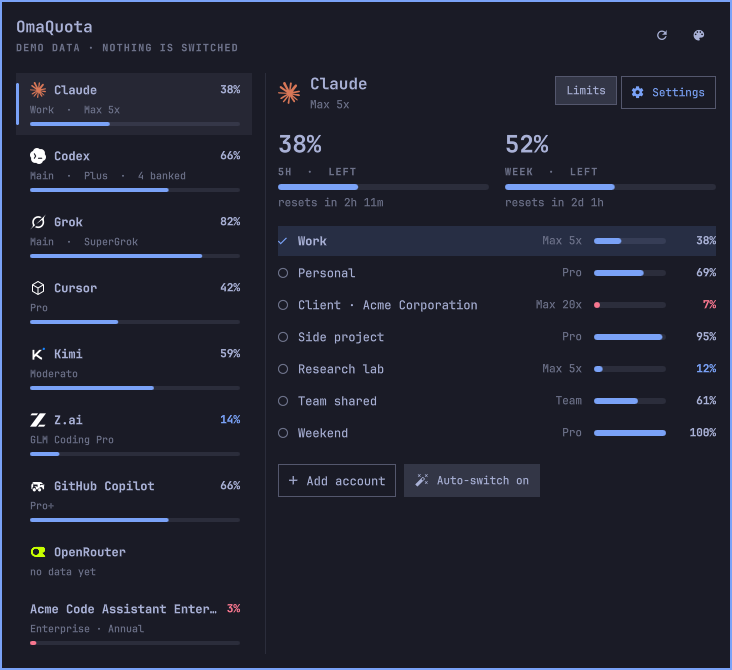

# OmaQuota

Usage limits, reset times and account switching for your coding agents, in
the Omarchy bar. Requires Omarchy 4.5 or newer.



## Features

- **Limits at a glance.** Pick, per agent, which limit appears in the bar
  (5-hour, weekly, monthly, or *Tightest*). The bar shows the agent's logo
  and what is left; the number turns red near the limit. Hover for every
  limit and its reset time.
- **One panel for every agent.** Agents are listed on the left with their
  tightest limit; the selected one fills the right with its limits, accounts
  and settings, so the panel stays compact with many agents.
- **Account switching** for Claude Code, Codex and Grok. Click any account to
  see its limits without switching; a green **Active** or red **Make active**
  button shows whether new sessions use it, and switches with one click. Sign
  in more accounts from the panel.
  Optional auto-switch moves new sessions to the account with the most room
  when one nears its limit.
- **Every account in the bar** (optional). Show each account's remaining
  share side by side, tagged by its initials.
- **Settings that follow the account** (Claude Code). Choose on/off keys of
  `settings.json`, such as *Remote control at startup*, per account; they are
  written when the account changes, wherever it is changed from.
- **Banked resets** (Codex). See how many free full resets you have and list
  each one with its deadline.
- **Other providers.** Any agent Omarchy has a usage collector for, such as
  Cursor, Kimi, z.ai, Copilot or OpenRouter, can be shown alongside.
- **Near-limit warnings.** One notification per limit window at a threshold
  you choose.
- **Usage details and files.** Today's and all-time prompts, sessions and
  tokens, and the files behind each agent with edit, copy-path and
  open-folder buttons.
- **Display options.** Panel size (Small, Medium, Large), Cards or Compact
  style, numbers as left, used or both, colour or mono logos, and a reset
  countdown in the bar.

## Requirements

- **Omarchy 4.5 or newer.** OmaQuota is built on the agent account commands
  and shell features introduced in Omarchy 4.5 (currently a release
  candidate). Omarchy 4.0.x is not supported. Check with
  `omarchy agent account --help`.
- `jq` and `notify-send` (shipped with Omarchy)
- `python3` (shipped with Omarchy), used to list Codex banked resets
- The agent CLIs you use, for example `claude`, `codex` or `grok`

## Install

```bash
omarchy plugin add https://github.com/basar-yilmaz/omarchy-omaquota --enable
```

Add more accounts from the panel's **Add account** button, or from a terminal:

```bash
omarchy agent account add claude Work
omarchy agent account add codex Personal
```

## Usage

| Action | Result |
| --- | --- |
| Hover the bar icon | Every limit, what is left and when it resets |
| Click | Open the panel |
| Right-click | Switch between Cards and Compact |
| Palette button | Display options |
| Click an account | Show its limits, without switching |
| **Active** / **Make active** | Green when new sessions use the account on show; red to switch to it |
| An agent's **Settings** button | Bar choice, usage details, files, per-account settings (click again to go back) |

Keys in the panel: `↑` `↓` agent · `←` `→` view an account · `Enter` make it active ·
`g` limits/settings · `r` refresh · `s` style · `Esc` close.

Switching changes the account that **new** sessions use. Running sessions
keep their account until restarted.

## Settings

Every setting is available from the panel. They can also be set from a
terminal, for example:

```bash
omarchy bar set io.github.basar-yilmaz.omaquota extraProviders "cursor,kimi,zai"
omarchy bar set io.github.basar-yilmaz.omaquota alertAt 85 --json
```

| Key | Default | Description |
| --- | --- | --- |
| `style` | `Cards` | `Cards` or `Compact` |
| `uiSize` | `Medium` | Panel size: `Small`, `Medium` or `Large` |
| `valueMode` | `Left` | Numbers show what is `Left`, `Used`, or `Both` |
| `logoStyle` | `Colour` | Bar logos in `Colour` or `Mono` |
| `barItems` | empty | Agents and limits in the bar, e.g. `claude:Week,codex:5h` |
| `barAllAccounts` | empty | Agents showing every account in the bar, e.g. `claude` |
| `barReset` | `false` | Reset countdown next to each agent in the bar |
| `showPercent` | `true` | Show the tightest limit next to the icon when no agent is in the bar |
| `extraProviders` | empty | Extra Omarchy usage collectors, e.g. `cursor,kimi,zai` |
| `alertAt` | `90` | Percent at which a warning is sent |
| `refreshIntervalSec` | `900` | Background refresh interval; short intervals can hit provider rate limits |
| `accountSettings` | `{}` | Per-account Claude Code settings, set from the panel |
| `demoFile` | empty | Show invented data instead of your own (see below) |

## How it works

OmaQuota builds on Omarchy's own agent commands and never reads, copies or
writes a login.

| Task | Handled by |
| --- | --- |
| Fetching limits | `omarchy agent usage update --limits-only` |
| Accounts and switching | `omarchy agent account list / use / mode / add` |
| Auto-switch for agents with several accounts | Omarchy's account check, run on each refresh |
| Warnings for other agents | OmaQuota, through `notify-send` |
| Per-account settings | `bin/apply-settings`, an atomic merge of on/off keys into `settings.json` |
| Codex banked resets | `bin/codex-resets`, which asks the Codex CLI, only when the list is opened |

Agent logos are read at runtime from Omarchy's agents plugin, so this
repository contains no brand assets.

## Demo mode

To try the layout with invented accounts and providers:

```bash
omarchy bar set io.github.basar-yilmaz.omaquota demoFile "$HOME/.config/omarchy/plugins/io.github.basar-yilmaz.omaquota/demo/accounts.json"
omarchy bar set io.github.basar-yilmaz.omaquota extraProviders "cursor,kimi,zai,copilot,openrouter,acme-agent"
```

Nothing is switched, written or notified while demo mode is on. Turn it off
with:

```bash
omarchy bar set io.github.basar-yilmaz.omaquota demoFile ""
omarchy bar set io.github.basar-yilmaz.omaquota extraProviders ""
```

## Update

```bash
omarchy plugin update io.github.basar-yilmaz.omaquota
```

## Remove

```bash
omarchy plugin remove io.github.basar-yilmaz.omaquota
```

Accounts stay in Omarchy's registry; remove them with
`omarchy agent account remove <provider> <account>`.

## Development

```bash
bash tests/run-all.sh
```

Runs a static check of `Panel.qml`, the unit tests, the helper script tests
and `omarchy plugin validate`.

## License

[MIT](LICENSE). Product names are trademarks of their respective owners;
OmaQuota is an independent project.
